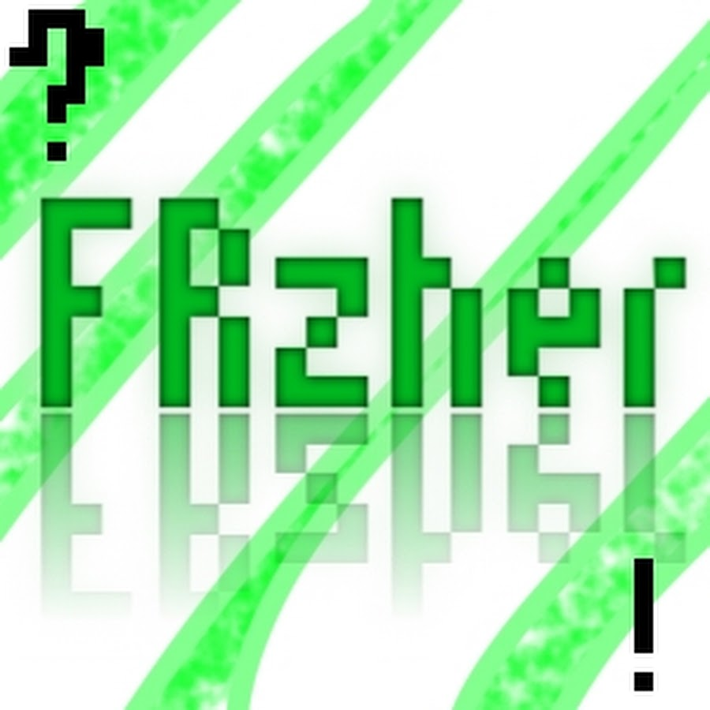

# 🚀 FRZlauncher

<p align="center">
  
</p>

<p align="center">
  <b>Современный, легковесный и высокопроизводительный модульный Minecraft лаунчер нового поколения.</b>
</p>

<p align="center">
  
  
  
  
  
  
</p>

---

## ✨ Основные возможности (Features)

- ⚡ **Максимальная производительность:** Ядро на Rust (Tauri v2) потребляет менее 50 МБ оперативной памяти в простое — никаких тяжелых оболочек на Electron.
- 🎨 **Полная кастомизация интерфейса:**
  - Настраиваемые акцентные цвета: *Изумрудный, Индиго, Киберпанк Циан, Закат, Неоновый Лайм, Рубиновый, Розовое золото*.
  - Выбор тем оформления, настройка прозрачности, блюра и возможность загрузки собственных обоев.
- 👤 **Мульти-аккаунтность с отображением скинов:**
  - Поддержка **Ely.by** (с авторизацией через OAuth / логин-пароль и загрузкой скинов).
  - Поддержка официальных аккаунтов **Microsoft**.
  - Быстрый локальный **Оффлайн-режим**.
- 🤖 **AI Mod Builder & Каталог модов:**
  - Умный поиск и авто-установка модов из **Modrinth** и **Minecraft Inside**.
  - Парсинг списков модов с автоматической очисткой спецсимволов, версий и разделителей (например, `Sodium | Lithium | Iris`).
- 🚀 **Оптимизация и Ultra FPS Boost:**
  - Автоматический подбор оптимальных JVM-аргументов и расчет оперативной памяти под характеристики вашего ПК.
  - Предустановленные пакеты оптимизации для максимального FPS на слабых и средних конфигурациях.
- 🎮 **Discord Rich Presence:**
  - Интеграция с Discord — отображение текущего статуса в лаунчере и в игре.
- 📦 **Полная изоляция инстансов:**
  - Чистое разделение версий, модов, конфигов и сохранений между сборками.

---

## 📥 Скачать (Download)

Перейдите на страницу [**Releases**](../../releases), чтобы загрузить последнюю стабильную версию:

- **`FRZlauncher_1.0.0_x64-setup.exe`** — Установщик для Windows с авто-созданием ярлыка.
- **`FRZlauncher_Portable.exe`** — Портативная версия без необходимости установки.

---

## 🛠️ Разработка и сборка (Development & Build)

### Требования
- **Node.js** v18+ и **npm**
- **Rust** 1.80+ (`rustup`)
- C++ Build Tools (Visual Studio 2022 с компонентом «Разработка классических приложений на C++»)

### Установка зависимостей
```bash
git clone https://github.com/FRzher/FRZlauncher.git
cd FRZlauncher
npm install
```

### Запуск в режиме разработки
```bash
npm run tauri dev
```

### Сборка релизной версии
```bash
npm run build:exe
```
Собранные бинарные файлы будут сгенерированы в:
- Инсталлятор: `target/release/bundle/nsis/FRZlauncher_1.0.0_x64-setup.exe`
- Исполняемый файл: `target/release/frzlauncher.exe`

### Запуск тестов
```bash
cd src-tauri
cargo test
```

---

## 📄 Лицензия (License)

Проект распространяется под лицензией [MIT](LICENSE).
Вы можете свободно использовать, модифицировать и распространять данный код.

---

## ⚖️ Правовая информация (Legal Disclaimer)

> **НЕ ЯВЛЯЕТСЯ ОФИЦИАЛЬНЫМ ПРОДУКТОМ MINECRAFT. НЕ ОДОБРЕНО И НЕ СВЯЗАНО С MOJANG ИЛИ MICROSOFT.**  
> **NOT AN OFFICIAL MINECRAFT PRODUCT. NOT APPROVED BY OR ASSOCIATED WITH MOJANG OR MICROSOFT.**

- «Minecraft» является зарегистрированным товарным знаком компании **Mojang Synergies AB / Microsoft Corporation**.
- **FRZlauncher** — это независимый сторонний проект с открытым исходным кодом. Разработчики лаунчера никак не связаны с Mojang AB, Microsoft Corporation или их аффилированными лицами, не одобряются ими и не спонсируются ими.
- Все товарные знаки, названия игр, логотипы и бренды принадлежат их законным правообладателям.

<p align="center">Made with ❤️ for the Minecraft Community</p>
